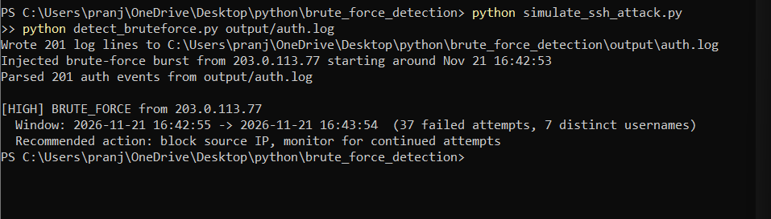

# Password Security Lab: Generation, Cracking, and Brute-Force Detection

A self-contained lab covering password security from both sides: how to
generate/audit strong credentials, how hash choice affects real
cracking time (John the Ripper), and how to detect brute-force attacks
against them. Mapped to **MITRE ATT&CK T1110 (Brute Force)**.

## Project structure

```
soc_password_project/
├── hashing_lab/
│   ├── strong_password.py     # secure password generator (secrets module)
│   ├── generate_hashes.py     # builds weak/medium/strong password set, hashes with MD5/SHA-256/bcrypt
│   └── plot_results.py        # charts crack-time results after you run John/Hashcat
├── password_auditor/
│   └── auditor.py             # checks passwords against HIBP (k-anonymity) + weak-pattern heuristics
├── brute_force_detection/
│   ├── simulate_ssh_attack.py # generates a synthetic auth.log with an injected brute-force burst
│   ├── detect_bruteforce.py   # Python detection logic (volume + spraying + success-after-burst)
│   ├── wazuh_rule_example.xml # the same detection logic as a Wazuh custom rule
│   └── splunk_spl_example.txt # the same detection logic as Splunk SPL searches
└── docs/
    └── MITRE_ATTACK_MAPPING.md
```

## How to run it end to end

### 1. Generate passwords and hashes
```bash
cd hashing_lab
pip install bcrypt --break-system-packages
python3 generate_hashes.py
```
This writes `output/md5_hashes.txt`, `sha256_hashes.txt`, `bcrypt_hashes.txt`,
and a `results_template.csv` to fill in.

### 2. Crack them with Hashcat or John the Ripper (in your own isolated VM)
Ubuntu's default `john` package only supports crypt-style formats
(bcrypt/md5crypt/descrypt), not raw MD5/SHA-256, so this lab uses
**hashcat** for those two:
```bash
cut -d: -f2 output/md5_hashes.txt > output/hc_md5.txt
cut -d: -f2 output/sha256_hashes.txt > output/hc_sha256.txt
cut -d: -f2 output/bcrypt_hashes.txt > output/hc_bcrypt.txt

hashcat -m 0 -a 0 output/hc_md5.txt /usr/share/john/password.lst -r /usr/share/hashcat/rules/best64.rule
hashcat -m 1400 -a 0 output/hc_sha256.txt /usr/share/john/password.lst -r /usr/share/hashcat/rules/best64.rule
hashcat -m 3200 -a 0 output/hc_bcrypt.txt /usr/share/john/password.lst
```
Record each run's wall-clock time against the matching rows in
`results_template.csv` (rename it to `results.csv`), then:
```bash
pip install matplotlib --break-system-packages
python3 plot_results.py
```
This produces `chart_time_by_algorithm.png` and `chart_entropy_vs_time.png`
for your writeup.

## Crack-Time Results (measured, not estimated)

**Test environment:** hashcat v6.2.6, CPU-only (no GPU), single-threaded
Intel Xeon @ 2.10GHz. All timings below are from actual runs, not
calculated from memory.

### Dictionary attack against 19 test passwords (weak/medium/strong mix)

| Algorithm | Attack | Passwords cracked | Time |
|---|---|---|---|
| MD5 | Wordlist only (3,559 words) | 5 / 19 | 40.6 sec (mostly startup overhead) |
| MD5 | Wordlist + best64 mutation rules | 8 / 19 | 2.4 sec |
| MD5 | Wordlist + targeted capitalize+digit+symbol rules | 15 / 19 | ~9 sec total (several rule passes) |
| bcrypt (cost factor 12) | Same wordlist, no rules | 4 / 19 (plain dictionary words only) | 20+ sec and still only 0.35% through the wordlist |

**The 4 passwords that never cracked** in any run above were the fully
random ones generated by `strong_password.py` (12, 16, 20, and 24
characters, mixed case + digits + symbols) - this is expected and is the
point of the lab.

### Raw hash rate benchmarks (hashcat `-b`, same hardware)

| Algorithm | Speed |
|---|---|
| MD5 | 245,400,000 hashes/sec |
| SHA-256 | 52,892,800 hashes/sec |
| bcrypt (cost 12) | 4 hashes/sec |

**bcrypt is roughly 61 million times slower than MD5 on identical
hardware** - this is the entire reason hash choice matters more than
almost anything else a defender controls.

### Projected brute-force time for fully random passwords (average-case, i.e. half the keyspace searched)

Calculated from the real measured speeds above - not looked up, not
assumed. Keyspace = 76 possible characters (26 lower + 26 upper + 10
digits + 14 symbols) raised to the password length.

| Length | Keyspace | MD5 | SHA-256 | bcrypt (cost 12) |
|---|---|---|---|---|
| 12 chars | 3.71 × 10²² | ~2.4 million years | ~11 million years | ~1.47 × 10¹⁴ years |
| 16 chars | 1.24 × 10³⁰ | ~8.0 × 10¹³ years | ~3.7 × 10¹⁴ years | ~4.9 × 10²¹ years |
| 20 chars | 4.13 × 10³⁷ | ~2.7 × 10²¹ years | ~1.2 × 10²² years | ~1.6 × 10²⁹ years |
| 24 chars | 1.38 × 10⁴⁵ | ~8.9 × 10²⁸ years | ~4.1 × 10²⁹ years | ~5.5 × 10³⁶ years |

**Caveats (stating these honestly makes the results more credible, not
less):**
- This hardware is CPU-only and single-threaded. A real attacker using a
  modern GPU cluster for MD5/SHA-256 would be roughly 100-1,000× faster
  than these numbers - though for a 16+ char random password it remains
  computationally infeasible regardless.
- bcrypt's cost factor is deliberately tunable - cost 12 was used here
  because it's a commonly recommended minimum for 2024+.
- These are *average-case* estimates (half the keyspace). Worst case
  doubles them; best case (attacker gets lucky on guess 1) isn't
  something a defender can rely on.

### 3. Audit a password against real breach data
```bash
cd ../password_auditor
python3 auditor.py "MyCandidatePassword123!"
```

### 4. Simulate and detect a brute-force attack
```bash
cd ../brute_force_detection
python3 simulate_ssh_attack.py
python3 detect_bruteforce.py output/auth.log
```
Compare the Python output against the equivalent logic in
`wazuh_rule_example.xml` and `splunk_spl_example.txt` to see the same
detection expressed in three different tools.

## Lessons learned

- **Hash choice matters more than almost anything else a defender
  controls.** The exact same password set took seconds to partially crack
  under MD5 and remained impractical to fully crack under bcrypt - the
  password strength didn't change, only the storage method did.
- **Dictionary + rules beats brute force in practice.** Every weak and
  medium password in this lab fell to a wordlist with mutation rules in
  under 10 seconds combined; none of it required brute-forcing the full
  keyspace. This is also why the detection logic in this project watches
  for failed-login *volume*, not just "someone is brute-forcing."
- **MFA matters even when passwords are strong**, and strong hashing
  matters even when passwords are weak - they're independent layers, and
  this lab's numbers show why neither one alone is sufficient.
- See `docs/MITRE_ATTACK_MAPPING.md` for how this maps to ATT&CK T1110 and
  its mitigations.

## Safety note

Only run John the Ripper, Hashcat, or any brute-force simulation against
systems and credentials you own or have explicit written permission to
test, inside an isolated lab/VM. `simulate_ssh_attack.py` only ever
generates synthetic log text - it never touches a real SSH service.


